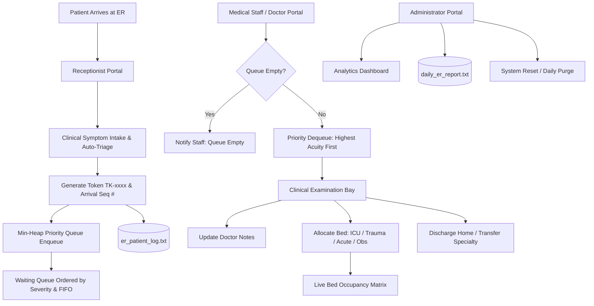

# HOSPITAL EMERGENCY MANAGEMENT SYSTEM

[](https://en.wikipedia.org/wiki/C11_(C_standard_revision))
[]()
[]()
[]()
[]()

---

## MOTIVATION FOR THIS PROJECT

Patients arriving at a hospital's emergency department (ER) require immediate medical attention, yet this process is often managed manually or without a standardized procedure. Such methods can be slow, leading to dangerous delays in treating critically ill patients, and become difficult to manage during high-pressure situations or periods of overcrowding. A lack of proper prioritization often results in long wait times for patients, while medical staff struggle to manage emergency care and bed allocation.

The primary objective of this project is to develop an integrated and efficient management system for the hospital ER that automates tasks such as patient registration, prioritization, and the tracking of patient location or movement within the department. This system facilitates the creation of priority-based patient queues and the management of emergency bed availability, while simultaneously minimizing human error and saving time during critical moments. It incorporates distinct access interfaces for medical staff—who admit and treat high-priority patients—and receptionists, who handle patient registration. Furthermore, by addressing a real-world healthcare challenge, students can gain practical insight into various C programming concepts, such as priority queue data structures, file handling, pointers, and functions.

---

## WEB DASHBOARD INTERFACE (UI)

A complementary responsive browser-based dashboard is provided in [`ui/index.html`](ui/index.html):
- **Live Priority Queue View**: Visual rendering of Min-Heap prioritized patients.
- **Active Examination Bay**: Real-time examination status card.
- **Interactive Emergency Bed Matrix**: 22 emergency beds with instant occupancy toggles.
- **Instant Simulation Controls**: Buttons to advance highest-priority cases and dynamically intake emergency arrivals.

Simply open [`ui/index.html`](ui/index.html) in any modern browser to view the interface.

---

## SYSTEM ARCHITECTURE



---

## DATA STRUCTURES & ALGORITHMS (DSA)

### 1. Min-Heap Priority Queue (`include/priority_queue.h`, `src/priority_queue.c`)
In a standard queue (FIFO), patients are served strictly by arrival order. In an emergency room, a patient suffering a cardiac arrest (Level 1) who arrives at 10:05 AM **must** be treated before a patient with a minor sprain (Level 4) who arrived at 09:30 AM.

- **Primary Sort Key**: `severity` (Level 1 is highest priority, Level 5 is lowest).
- **Tie-Breaking Rule**: `arrival_order` (Strict FIFO sequence for patients with identical triage levels).
- **Comparator Logic**:
  ```c
  if (a->severity != b->severity) {
      return a->severity < b->severity; // Level 1 < Level 2
  }
  return a->arrival_order < b->arrival_order; // Earlier arrival sequence first
  ```

### Complexity Breakdown

| Operation | Function | Time Complexity | Space Complexity |
| :--- | :--- | :--- | :--- |
| **Enqueue** | `pq_enqueue()` | $\mathcal{O}(\log N)$ | $\mathcal{O}(1)$ |
| **Dequeue (Serve Top Priority)** | `pq_dequeue()` | $\mathcal{O}(\log N)$ | $\mathcal{O}(1)$ |
| **Peek Next Patient** | `pq_peek()` | $\mathcal{O}(1)$ | $\mathcal{O}(1)$ |
| **Search Patient by Token** | `pq_find_by_token()` | $\mathcal{O}(N)$ | $\mathcal{O}(1)$ |
| **Clinical Re-triage & Rebalance** | `pq_update_severity()` | $\mathcal{O}(N + \log N)$ | $\mathcal{O}(1)$ |
| **Sorted Queue Display Table** | `pq_get_sorted_list()` | $\mathcal{O}(N \log N)$ | $\mathcal{O}(N)$ |

---

## EMERGENCY SEVERITY INDEX (ESI) TRIAGE SCALE

| Level | Classification | Target Wait Time | Typical Clinical Presentations |
| :---: | :--- | :--- | :--- |
| **1** | **CRITICAL / RESUSCITATION** | **Immediate (0 min)** | Cardiac arrest, respiratory failure, massive polytrauma, shock |
| **2** | **EMERGENT** | **< 10 minutes** | Acute chest pain (STEMI), stroke symptoms, severe acute asthma |
| **3** | **URGENT** | **< 30 minutes** | Severe abdominal pain, closed fractures, high persistent fever |
| **4** | **LESS URGENT** | **< 60 minutes** | Simple lacerations requiring sutures, sprains, mild vomiting |
| **5** | **NON-URGENT** | **< 120 minutes** | Prescription refill, rash, cold/flu, minor abrasions |

---

## EMERGENCY BED ALLOCATION MATRIX

The emergency department manages **22 dedicated beds** divided into specialized care units:
- **ICU / Resuscitation Beds (`ICU-01` to `ICU-04`)**: 4 beds reserved for Level 1 critical emergencies.
- **Trauma Bays (`TRM-01` to `TRM-04`)**: 4 bays equipped for motor vehicular collisions and major trauma.
- **Acute Emergency Beds (`ER-01` to `ER-08`)**: 8 general acute emergency care beds.
- **Observation Units (`OBS-01` to `OBS-06`)**: 6 observation beds for semi-urgent monitoring and IV therapy.

---

## PERSISTENT FILE STORAGE

1. **`er_patient_log.txt`**:
   - Permanent audit log recording every patient registration, triage acuity, clinical notes, and discharge event with timestamps.
2. **`daily_er_report.txt`**:
   - Comprehensive end-of-shift operational audit report containing patient volume, triage breakdown, and unit-level bed occupancy statistics.

---

## ROLE-BASED ACCESS CONTROL (RBAC)

- **Receptionist Portal**: Patient registration, automatic triage recommendation, token generation, live queue viewing, and serving status monitoring. (Direct access)
- **Medical Staff / Doctor Portal**: Priority dequeue, clinical examination notes, bed admission, patient discharge/transfer, and waiting patient re-triage. (Protected by Doctor PIN: `1234`)
- **Administrator Portal**: Analytics dashboard, daily report generation, bed matrix inspection, log viewing, and system reset. (Protected by Admin PIN: `9999`)

---

## COMPILATION & EXECUTION

### Prerequisites
- GCC / MinGW compiler supporting C11 standard (`gcc --version`)
- Make (optional)

### Option A: Using Windows Batch Script
```bat
build.bat
hospital_er.exe
```

### Option B: Using Makefile
```bash
make
./hospital_er.exe
```

### Option C: Direct GCC Command
```bash
gcc -Wall -Wextra -std=c11 -Iinclude src/*.c -o hospital_er.exe
./hospital_er.exe
```

### Running Automated Test Suite (DSA Verification)
```bash
gcc -Wall -Wextra -std=c11 -Iinclude src/patient.c src/triage.c src/priority_queue.c src/bed_manager.c src/file_io.c tests/test_priority_queue.c -o test_runner.exe
./test_runner.exe
```

---

## FAQ (VIVA VOCE QUESTIONS & ANSWERS)

#### 1. What is your project?
**Answer**: Our project is a Hospital Emergency Management System, a console-based C application that manages emergency patient registration, triage, priority-based queue processing, patient status, bed allocation, and daily records.

#### 2. What is the main objective?
**Answer**: The main objective is to organize emergency patients according to the severity of their condition and maintain their records efficiently using a priority queue and file handling.

#### 3. Why did you choose this project?
**Answer**: We chose it because emergency departments need an organized way to handle patients when multiple patients arrive at the same time. A priority-based system can help represent which patient should be processed first.

#### 4. What is the main DSA concept used?
**Answer**: The main DSA concept is a **Min-Heap Priority Queue** ordered by clinical severity with strict FIFO arrival sequence tie-breaking.

#### 5. Why did you use a Priority Queue instead of a normal queue?
**Answer**: A normal queue follows FIFO — First In, First Out. But in an emergency department, the most critical patient (Level 1) must be treated immediately before someone with a minor complaint who arrived earlier. Therefore, a priority queue is medically appropriate.

#### 6. What are enqueue and dequeue?
**Answer**:
- **Enqueue**: Adding a newly registered patient to the priority queue in $\mathcal{O}(\log N)$ time using heap sift-up.
- **Dequeue**: Removing and serving the highest-priority patient in $\mathcal{O}(\log N)$ time using heap sift-down.

#### 7. How is patient priority decided?
**Answer**: The priority is based on the Emergency Severity Index (ESI) triage level (1 to 5) assigned during registration, with Level 1 being the highest priority.

#### 8. What happens when a new patient arrives?
**Answer**:
```
Patient Registration -> Token Generation -> Severity Assignment -> Patient Structure Created -> Enqueue into Priority Queue -> Save Record to er_patient_log.txt
```

#### 9. What programming language did you use?
**Answer**: We used C (C11 standard).

#### 10. What C concepts are used?
**Answer**:
- Structures (`struct Patient`, `struct Bed`, `struct PriorityQueue`)
- Enums (`TriageLevel`, `PatientStatus`, `BedType`)
- Dynamic memory allocation (`malloc`, `realloc`, `free`)
- Pointers and pass-by-reference
- File handling (`fopen`, `fprintf`, `fgets`, `fclose`)
- ANSI terminal escape sequences for cross-platform color display
- Menu-driven modular architecture

#### 11. Why are structures used?
**Answer**: Structures group heterogeneous attributes of a patient (Token, Name, Age, Contact, Severity, Bed ID, Notes) into a single cohesive data unit.

#### 12. Why is file handling required?
**Answer**: In-memory data is volatile. File handling ensures that all intake events, doctor notes, and daily operational reports persist across program restarts and system shutdowns.

#### 13. Which files are used?
**Answer**:
- `er_patient_log.txt`: Audit log storing complete patient intake and clinical progression events.
- `daily_er_report.txt`: Daily emergency department summary report.

#### 14. What is the role of the receptionist?
**Answer**: The receptionist registers patients, enters symptoms, assists with severity assignment, generates unique tokens (`TK-xxxx`), enqueues into the priority queue, and checks live waiting queue depth.

#### 15. What is the role of medical staff/admin?
**Answer**:
- **Medical Staff / Doctor**: Dequeues highest-acuity patients, records diagnoses, allocates specialized emergency beds, discharges or transfers patients, and escalates waiting patients whose condition deteriorates.
- **Admin**: Views executive analytics, generates official daily reports, reviews audit logs, and performs end-of-day resets.

#### 16. What is role-based access?
**Answer**: It restricts privileges based on operational roles: receptionists handle intake, while clinical decisions (dequeuing, bed assignment, discharge) and administrative resets require authorized role credentials.

#### 17. What happens if the priority queue is empty?
**Answer**: The system checks `pq_is_empty()` prior to performing any dequeue operation. If empty, the medical staff is notified and no crash or memory underflow occurs.

#### 18. What happens when a patient is served?
**Answer**: The highest-priority patient is extracted from the root of the heap, assigned `UNDER_TREATMENT` status, logged to `er_patient_log.txt`, and made active in the examination bay.

#### 19. What is the limitation of your project?
**Answer**: The current system is a terminal console application with local file persistence, suitable for local clinic/hospital deployment without distributed network sync.

#### 20. What are future possibilities?
**Answer**:
- Relational database integration (PostgreSQL / SQLite)
- Web-based front-end dashboard (React/Vite)
- Real-time IoT vitals monitor integration
- Multi-hospital emergency bed telemetry network
- Blockchain-backed tamper-proof medical audit trail

#### 21. Can blockchain be used in this project?
**Answer**: Yes, as a future enhancement for cryptographic proof of patient record integrity and immutable triage audit logs.

#### 22. What is the biggest advantage of your system?
**Answer**: It eliminates human scheduling bias and dangerous delays by automatically routing life-threatening cases to physicians first while ensuring fair FIFO treatment for patients with equal severity.

#### 23. What happens if two patients have the same priority?
**Answer**: The system uses a strict **FIFO tie-breaking rule**: a monotonic arrival order counter ensures that between patients of identical severity, the one who arrived earlier is dequeued first.

---

## AUTHORS

- [@Sahil Roy](https://github.com/sahilroykgp-art)

## 🚀 ABOUT ME
I'm a Computer Applications student specialized in Artificial Intelligence & Data Science.
